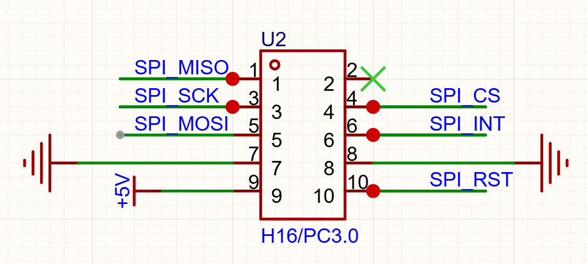
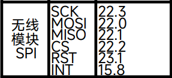

# SPI_WIFI 图传传参的软硬件使用方法总结

<AuthorByline date="2026-10-19" category="智能车" />

## 硬件部分

### 1. 接口

该模块需要使用 **2×5 排座**，排座间距为 **2.54 mm**。

### 2. 主控引脚连接

主控引脚可以参考逐飞提供的默认引脚配置。相关定义和示例代码可在逐飞的 Gitee 开源仓库中查找。

## 软件部分

### 1. 基本功能与官方例程

软件部分可以从逐飞提供的示例工程入手，先完成模块初始化和通信测试，再逐步加入参数传输、无线图像传输等功能。使用逐飞上位机后，可以在电脑端无线接收主控发送的数据和高帧率图像，调试效率直接坐火箭。

### 2. 可扩展方向

如果有进一步开发的计划，可以尝试自行设计上位机，将无线图像接收、参数调节和算法调试集成到同一个界面中。例如，在接收原始图像的同时，实时显示二值化图像结果、赛道中线和其他关键调试信息。
